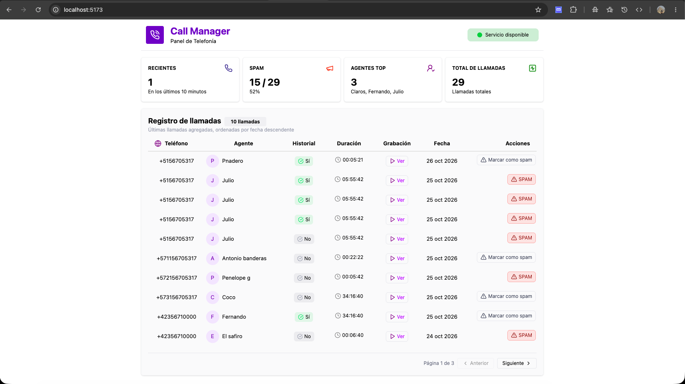

# 📞 Call Manager — Live Inbound Call System

Sistema de gestión y recepción de llamadas entrantes en tiempo real con registro idempotente en dos capas (Redis + PostgreSQL), detección automática de clientes recurrentes, clasificación interactiva de SPAM y transmisión reactiva vía WebSockets (Laravel Reverb).

---

## 📸 Vista Previa del Dashboard



---

## 🚀 Características Principales

- **Idempotencia Dual Robusta**:
  - **Capa 1 (Redis)**: Candado distribuido atómico (`SET NX EX`) y replay-cache para responder duplicados en menos de 2 milisegundos sin consultar PostgreSQL.
  - **Capa 2 (PostgreSQL)**: Restricción `UNIQUE (call_id)` para consistencia ACID absoluta ante concurrencia extrema.
- **Detección Automática de Recurrencia**:
  - Consulta instantánea en PostgreSQL mediante índice B-Tree en `phone_number` para determinar si el cliente ya había llamado antes (`has_called_before`).
- **Tiempo Real con WebSockets Nativos**:
  - Servidor WebSocket con **Laravel Reverb** integrado en Docker.
  - El frontend se actualiza solo en milisegundos mediante **Laravel Echo** y mutación de caché en **TanStack Query**, sin recargas de página.
- **Clasificación de SPAM**:
  - Mutación interactiva en tiempo real para marcar llamadas sospechosas desde el dashboard.
- **Clean Architecture & Feature-Based Frontend**:
  - Separación estricta en el Backend: `Domain/` (puro), `Application/` (Casos de Uso) e `Infrastructure/` (Controladores, Repositorios Eloquent, Redis).
  - Frontend modular desacoplado: clientes agnósticos, Server State gestionado con TanStack Query y componentes presentacionales puros.
- **Zero Local Dependencies**:
  - Entorno 100% contenerizado en Docker. No requiere PHP, Composer, Node ni NPM instalados en la máquina host.

---

## 🛠️ Stack Tecnológico

| Capa | Tecnologías |
|---|---|
| **Backend** | PHP 8.4, Laravel 11/13, Laravel Reverb (WebSockets) |
| **Bases de Datos & Caché** | PostgreSQL 16 (Alpine), Redis (Alpine) |
| **Frontend** | React 18, Vite, TypeScript, TanStack Query, TailwindCSS, Laravel Echo |
| **Infraestructura** | Docker & Docker Compose |

---

## 📋 Requisitos Previos

- [Docker Desktop](https://www.docker.com/products/docker-desktop/) (o Docker Engine + Docker Compose) instalado y en ejecución.

---

## ⚙️ Guía de Instalación y Puesta en Marcha

### 1. Clonar el repositorio
```bash
git clone <URL_DEL_REPOSITORIO>
cd call-manager
```

### 2. Configurar las Variables de Entorno

Copia los archivos de ejemplo para cada servicio:

```bash
# Variables del entorno Docker
cp docker/.env.example docker/.env 2>/dev/null || cp docker/.env docker/.env

# Variables del Backend (API)
cp api/.env.example api/.env

# Variables del Frontend (React + Vite)
cp front/.env-example front/.env 2>/dev/null || cp front/.env.example front/.env 2>/dev/null
```

> **Nota**: Verifica que en `api/.env` tengas configurado:
> ```ini
> BROADCAST_CONNECTION=reverb
> REVERB_HOST="reverb"
> REVERB_PORT=8080
> ```

---

### 3. Levantar los Contenedores con Docker

Ejecuta el siguiente comando para compilar y levantar los 4 servicios (`api`, `postgres`, `redis`, `reverb` y `front`):

```bash
docker compose -f docker/docker-compose.yml up -d --build
```

Verifica que todos los servicios estén en estado `Up`:
```bash
docker compose -f docker/docker-compose.yml ps
```

---

### 4. Ejecutar las Migraciones de la Base de Datos

Corre las migraciones en PostgreSQL a través del contenedor de la API:

```bash
docker compose -f docker/docker-compose.yml exec api php artisan migrate
```

---

## 🌐 URLs de Acceso a la Aplicación

- **Frontend Dashboard**: [http://localhost:5173](http://localhost:5173)
- **Backend API**: [http://localhost:8000](http://localhost:8000)
- **Servidor WebSocket (Reverb)**: `ws://localhost:8080`

---

## 🧪 Pruebas de la API (cURL)

### 1. Registrar una Nueva Llamada (Cliente Primerizo)
```bash
curl -X POST http://localhost:8000/api/webhooks/calls \
  -H "Content-Type: application/json" \
  -d '{
    "call_id": "call_twilio_001",
    "phone_number": "+573001234567",
    "agent": "Fernando Claros",
    "duration": 180,
    "recording_url": "https://api.twilio.com/recordings/call_001.mp3"
  }'
```
👉 *Resultado*: Responde HTTP 200 con `"has_called_before": false`, `"is_idempotent_replay": false` y la llamada aparece en vivo en el navegador.

---

### 2. Probar Idempotencia (Reintento con el mismo `call_id`)
Vuelve a ejecutar exactamente el mismo comando anterior:
```bash
curl -X POST http://localhost:8000/api/webhooks/calls \
  -H "Content-Type: application/json" \
  -d '{
    "call_id": "call_twilio_001",
    "phone_number": "+573001234567",
    "agent": "Fernando Claros",
    "duration": 180,
    "recording_url": "https://api.twilio.com/recordings/call_001.mp3"
  }'
```
👉 *Resultado*: Responde HTTP 200 en 1 milisegundo desde Redis con `"is_idempotent_replay": true`, sin duplicar registros en PostgreSQL.

---

### 3. Probar Detección de Cliente Recurrente
Envía un `call_id` nuevo con el **mismo número telefónico**:
```bash
curl -X POST http://localhost:8000/api/webhooks/calls \
  -H "Content-Type: application/json" \
  -d '{
    "call_id": "call_twilio_002",
    "phone_number": "+573001234567",
    "agent": "Ana Gomez",
    "duration": 95,
    "recording_url": "https://api.twilio.com/recordings/call_002.mp3"
  }'
```
👉 *Resultado*: Detecta que el teléfono ya existía en la base de datos y responde `"has_called_before": true`.

---

### 4. Marcar Llamada como SPAM
```bash
curl -X PATCH http://localhost:8000/api/calls/call_twilio_001/spam
```
👉 *Resultado*: Transiciona el estado a SPAM, persiste en PostgreSQL y actualiza la caché en Redis.

---

## 👨‍💻 Autor

Desarrollado por **Fernando Claros** para prueba técnica Senior Full Stack.
